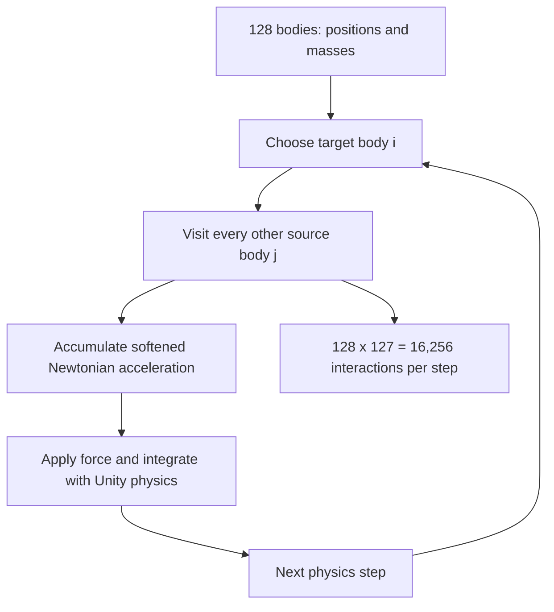

# Unity Processing and Simulation Examples

This Unity project presents five workloads: Gravity 2D, Gravity 3D, Simple Iteration, PSO, and Random Search. Each workload compares its Unity/C# processing methods with Python single-thread, Python threads, Python processes, and NumPy vectorized processing in the local dashboard.

## The five examples

1. **Gravity simulation (2D)** — circle sprites and Unity 2D physics. Read [`GravitySimulation/2D/README.md`](Assets/Examples/GravitySimulation/2D/README.md).
2. **Gravity simulation (3D)** — sphere meshes and Unity 3D physics. Read [`GravitySimulation/3D/README.md`](Assets/Examples/GravitySimulation/3D/README.md).
3. **Simple iteration** — the beginner-friendly batch calculation. Read [`SimpleIteration/README.md`](Assets/Examples/SimpleIteration/README.md).
4. **PSO simulation** — Particle Swarm Optimization. Read [`PSOSimulation/README.md`](Assets/Examples/PSOSimulation/README.md).
5. **Random Search optimization** — candidate sampling with a best-so-far result. Read [`RandomSearchOptimization/README.md`](Assets/Examples/RandomSearchOptimization/README.md).

## Local real-time dashboard

To fill every dashboard tab in one run, open `Assets/WebDashboard/Scenes/All_Examples_Benchmark.unity` and press **Play**. It runs Gravity 2D, Gravity 3D, Simple Iteration, PSO, and Random Search one after another. Unity serves the page locally at [http://127.0.0.1:8765/](http://127.0.0.1:8765/), and the browser saves each finished example on this PC. You can still run an individual `Gravity_Benchmark`, `SimpleIteration_Benchmark`, or `Optimization_Benchmark` scene when you only want that workload.

Dashboard assets and its README are under [`Assets/WebDashboard`](Assets/WebDashboard/README.md).

### Compare Python with Unity

Python runs as a separate local process after each Unity workload finishes. Press **Play** on a gravity, Simple Iteration, or `Optimization_Benchmark` scene to compare that workload. `All_Examples_Benchmark` runs Gravity 2D, Gravity 3D, Simple Iteration, PSO, and Random Search in sequence. The four Python methods are added to the corresponding dashboard tab and headless report.

The first run checks for NumPy. If needed, it creates a project-local Python environment under ignored `Library/PythonBatchBenchmark/venv` and installs NumPy there. Python 3 must be installed and available as `py` or `python` on `PATH`. Later runs reuse that environment. The benchmark can also be run on its own from PowerShell:

```powershell
py -3 Tools/PythonBatchBenchmark/setup_and_run.py
```

The report is written to `Library/PythonBatchBenchmark/results.json`. The Unity launcher passes the matching settings for the selected workload: item count and iterations, ball count and 2D/3D dimension, or particle/evaluation and trial counts. Standalone runs can select a workload with `--workload simple-iteration`, `gravity`, `pso`, or `random-search`. Unity starts Python after its own passes so the two runtimes do not compete for CPU during measurements.

Examples for running an individual Python workload from PowerShell:

```powershell
py -3 Tools/PythonBatchBenchmark/setup_and_run.py --workload gravity --dimension 3D --balls 128
py -3 Tools/PythonBatchBenchmark/setup_and_run.py --workload pso --particles 64 --iterations 99 --trials 5
py -3 Tools/PythonBatchBenchmark/setup_and_run.py --workload random-search --evaluations 6400 --trials 5
```

Python threads and processes split independent batches where the algorithm allows it; CPU-bound Python threads are limited by the Global Interpreter Lock in standard CPython. Process timing includes task scheduling and data transfer. NumPy uses native vector operations. Python has no Unity frame timings; gravity runs the same formula on a fixed deterministic layout, while Unity continues integrating physics and resolving collisions. Compare compute averages for algorithm cost; frame or wall times include different runtime overhead. Python and Unity can also differ slightly because their numeric operations use different precision.

## Headless benchmarks

Close the Unity Editor before using a headless helper. Use the Unity Editor executable installed on your computer:

```powershell
.\Tools\Run-HeadlessGravityBenchmark.ps1 `
  -UnityEditorPath "C:\Program Files\Unity\Hub\Editor\6000.5.1f1\Editor\Unity.exe" `
  -Dimension 2D

.\Tools\Run-HeadlessBatchBenchmark.ps1 `
  -UnityEditorPath "C:\Program Files\Unity\Hub\Editor\6000.5.1f1\Editor\Unity.exe"

.\Tools\Run-HeadlessOptimizationBenchmark.ps1 `
  -UnityEditorPath "C:\Program Files\Unity\Hub\Editor\6000.5.1f1\Editor\Unity.exe"
```

Reports are saved under `Build/Headless/`. The dashboard build can be used for live presentation; headless reports are for command-line profiling.

### Example gravity benchmark result

These are historical measurements from a Windows headless player run on **October 17, 2026**, with the laptop connected to AC power. Each 2D and 3D scene simulated 128 bodies and computed softened Newtonian attraction from every other body. Unity ran a 2-second warm-up and collected profiler samples for 8 seconds per strategy. Unity Coroutine has since been removed from the gravity examples. The C# async result predates the change to one `Task.Run` per target body; rerun the benchmark to measure the current methods.

| Unity gravity strategy | 2D average (ms/step) | 2D P95 (ms/step) | 3D average (ms/step) | 3D P95 (ms/step) |
| --- | ---: | ---: | ---: | ---: |
| Single threaded | 1.18 | 1.28 | 1.97 | 2.69 |
| C# async | 1.20 | 1.33 | 1.72 | 2.55 |
| C# parallel | 0.52 | 0.58 | 0.84 | 1.26 |
| Unity Jobs | 0.64 | 0.69 | 0.93 | 1.42 |
| Unity coroutine | 1.35 | 1.74 | 2.12 | 2.96 |
| Unity Jobs + Burst | 0.12 | 0.14 | 0.17 | 0.26 |

The timing is the average and 95th-percentile cost of one complete gravity calculation, measured with the Unity Profiler marker for each strategy. Each strategy uses the same deterministic starting layout and ball count; Unity then integrates motion and resolves collisions during the run. This player folder did not include the separate Python harness, so these tables report Unity methods only.

For `N = 128` bodies, each target checks `N - 1` source bodies. That is `128 × 127 = 16,256` directed source-target evaluations per physics step, with quadratic work and linear storage.

```text
a_i += G * m_j * (x_j - x_i) / (|x_j - x_i|² + softening²)^(3/2)
```



#### Test environment and settings

| Setting | Value |
| --- | --- |
| Machine | Microsoft Surface Laptop 5 |
| CPU | 12th Gen Intel Core i7-1255U; 10 cores, 12 logical processors |
| Memory | 16 GB RAM |
| Operating system | Windows 11 Home, build 26300, 64-bit |
| Unity | 6000.5.1f1; Standalone Windows x64 Development build |
| Power | AC connected; Balanced power plan; battery status reported charging (2) |
| Environment variables | `PROCESSOR_ARCHITECTURE=AMD64`; `NUMBER_OF_PROCESSORS=12` |
| Benchmark-specific environment variables | None; settings are passed as command-line arguments |
| Player flags | `-batchmode -nographics`; headless mode sets VSync to 0 and targets 60 FPS |
| Workload flags | `-gravity-benchmark-dimension 2D` or `3D`; warm-up `2` seconds; measurement `8` seconds |

The reports and a PowerShell rerun script are in `%USERPROFILE%\Desktop\GravitySimulation-Headless\`. From PowerShell, run `& "$env:USERPROFILE\Desktop\GravitySimulation-Headless\Run-Benchmark.ps1"`; the JSON and CSV reports are written beside the player. For the source-project helper, close the Unity Editor first and run `Tools/Run-HeadlessGravityBenchmark.ps1` with the installed Editor path and `-Dimension 2D` or `3D`.

These figures describe one local run, not a general ranking. CPU power limits, background work, and hardware can change timings. The exact machine snapshot and run arguments are also saved in `benchmark-environment.txt` beside the Desktop player.

## Folder layout

```text
Assets/
├── Examples/
│   ├── GravitySimulation/
│   │   ├── 2D/                  Scenes, scripts, resources, editor tools, and docs
│   │   ├── 3D/                  Scenes, scripts, resources, editor tools, and docs
│   │   └── Editor/              Shared gravity comparison-scene tools
│   ├── SimpleIteration/         Scenes, scripts, resources, editor tools, and docs
│   ├── PSOSimulation/           Scenes, scripts, resources, editor tools, and docs
│   └── RandomSearchOptimization/ Scenes, scripts, resources, editor tools, and docs
└── WebDashboard/                Local dashboard page, runner, scenes, editor tools, docs
```

Unity version: **6000.5.1f1**. Packages are listed in `Packages/manifest.json`.
