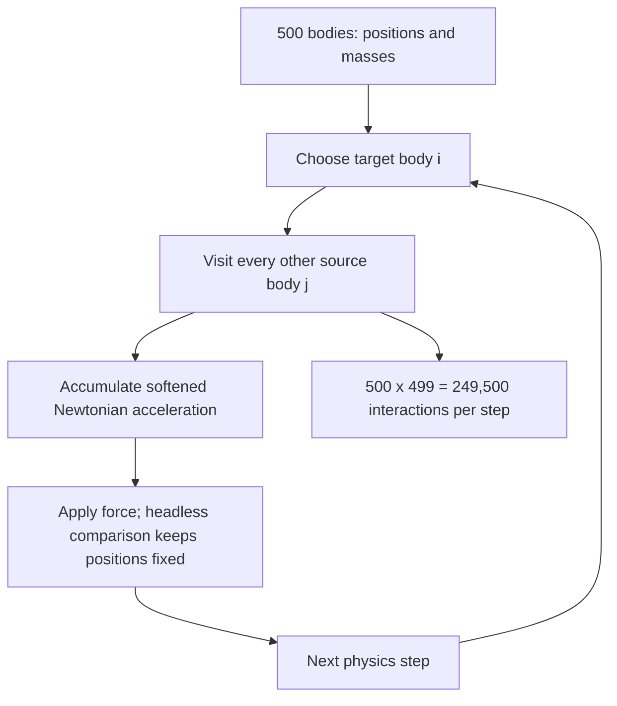

# Unity Processing and Simulation Examples

This Unity project presents four workloads: Gravity 2D, Gravity 3D, Simple Iteration, and Random Search. Each workload compares Unity/C# processing methods in the local dashboard.

## The four examples

1. **Gravity simulation (2D)** — circle sprites and Unity 2D physics. Read [`GravitySimulation/2D/README.md`](Assets/Examples/GravitySimulation/2D/README.md).
2. **Gravity simulation (3D)** — sphere meshes and Unity 3D physics. Read [`GravitySimulation/3D/README.md`](Assets/Examples/GravitySimulation/3D/README.md).
3. **Simple iteration** — the beginner-friendly batch calculation. Read [`SimpleIteration/README.md`](Assets/Examples/SimpleIteration/README.md).
4. **Random Search optimization** — candidate sampling with a best-so-far result. Read [`RandomSearchOptimization/README.md`](Assets/Examples/RandomSearchOptimization/README.md).

## Local real-time dashboard

To fill every dashboard tab in one run, open `Assets/WebDashboard/Scenes/All_Examples_Benchmark.unity` and press **Play**. It runs Gravity 2D, Gravity 3D, Simple Iteration, and Random Search one after another. Unity serves the page locally at [http://127.0.0.1:8765/](http://127.0.0.1:8765/), and the browser saves each finished example on this PC. You can still run an individual `Gravity_Benchmark`, `SimpleIteration_Benchmark`, or `Optimization_Benchmark` scene when you only want that workload.

Dashboard assets and its README are under [`Assets/WebDashboard`](Assets/WebDashboard/README.md).

## Headless benchmarks

Close the Unity Editor before using a headless helper. Use the Unity Editor executable installed on your computer:

```powershell
.\Tools\Run-HeadlessGravityBenchmark.ps1 `
  -UnityEditorPath "C:\Program Files\Unity\Hub\Editor\6000.5.1f1\Editor\Unity.exe" `
  -Dimension 2D

.\Tools\Run-HeadlessBatchBenchmark.ps1 `
  -UnityEditorPath "C:\Program Files\Unity\Hub\Editor\6000.5.1f1\Editor\Unity.exe"

.\Tools\Run-HeadlessOptimizationBenchmark.ps1 `
  -UnityEditorPath "C:\Program Files\Unity\Hub\Editor\6000.5.1f1\Editor\Unity.exe"
```

Reports are saved under `Build/Headless/`. The dashboard build can be used for live presentation; headless reports are for command-line profiling.

### Example gravity benchmark result

#### Latest headless run: 2D, 500 balls

A Windows standalone Development Player compared all five Unity gravity strategies with **500 balls**, a **2-second warm-up**, and **8 seconds of measurement per strategy** on October 19, 2026. This headless benchmark freezes Unity physics integration while leaving each strategy's `FixedUpdate` gravity calculation active. That holds the same deterministic starting positions across methods and prevents collision solving from dominating the algorithm comparison.

| Unity gravity strategy | Compute average (ms/step) | Compute P95 (ms/step) | Profiler samples |
| --- | ---: | ---: | ---: |
| Single threaded | 13.329 | 14.075 | 400 |
| C# async | 2.495 | 3.888 | 400 |
| C# parallel | 2.408 | 2.783 | 401 |
| Unity Jobs | 2.669 | 3.328 | 400 |
| Unity Jobs + Burst | 0.553 | 0.883 | 400 |

At 500 balls, each physics step computes **500 × 499 = 249,500 directed source-target interactions**. The player targets 60 FPS, and its frame times were about 16.67 ms for every method, so frame timing is not a useful ranking in this isolated headless run. The table ranks the measured gravity-calculation marker only.

#### Historical 2D measurement: 128 balls

Historical 2D measurements below are from a Windows headless player run on **October 17, 2026**, with the laptop connected to AC power. The scene simulated 128 bodies and computed softened Newtonian attraction from every other body. Unity ran a 2-second warm-up and collected profiler samples for 8 seconds per strategy. Unity coroutine has since been removed; its row is retained only as a historical result. The C# async result predates the change to one `Task.Run` per target body; rerun the benchmark to measure the current methods.

| Unity gravity strategy | 2D average (ms/step) | 2D P95 (ms/step) |
| --- | ---: | ---: |
| Single threaded | 1.18 | 1.28 |
| C# async | 1.20 | 1.33 |
| C# parallel | 0.52 | 0.58 |
| Unity Jobs | 0.64 | 0.69 |
| Unity coroutine (historical) | 1.35 | 1.74 |
| Unity Jobs + Burst | 0.12 | 0.14 |

The timing is the average and 95th-percentile cost of one complete gravity calculation, measured with the Unity Profiler marker for each strategy. Both runs use the same deterministic starting layout for each method. In the latest 500-ball run, physics integration is paused; the historical 128-ball run integrated motion and resolved collisions. These tables report Unity methods only.

For the historical `N = 128` run, each target checked `N - 1` source bodies: `128 × 127 = 16,256` directed source-target evaluations per 2D physics step. The latest `N = 500` run performs `500 × 499 = 249,500`. Both use quadratic work and linear storage.

```text
a_i += G * m_j * (x_j - x_i) / (|x_j - x_i|² + softening²)^(3/2)
```



#### Test environment and settings

| Setting | Value |
| --- | --- |
| Machine | Microsoft Surface Laptop 5 |
| CPU | 12th Gen Intel Core i7-1255U; 10 cores, 12 logical processors |
| Memory | 16 GB RAM |
| Operating system | Windows 11 Home, build 26300, 64-bit |
| Unity | 6000.5.1f1; Standalone Windows x64 Development build |
| Power | AC connected; Balanced power plan; battery status reported charging (2) |
| Environment variables | `PROCESSOR_ARCHITECTURE=AMD64`; `NUMBER_OF_PROCESSORS=12` |
| Benchmark-specific environment variables | None; settings are passed as command-line arguments |
| Player flags | `-batchmode -nographics`; headless mode sets VSync to 0 and targets 60 FPS |
| Workload flags | `-gravity-benchmark-dimension 2D`; warm-up `2` seconds; measurement `8` seconds |

The reports and a PowerShell rerun script are in `%USERPROFILE%\Desktop\GravitySimulation-Headless\`. From PowerShell, run `& "$env:USERPROFILE\Desktop\GravitySimulation-Headless\Run-Benchmark.ps1"`; the JSON and CSV reports are written beside the player. For the source-project helper, close the Unity Editor first and run `Tools/Run-HeadlessGravityBenchmark.ps1` with the installed Editor path and `-Dimension 2D`.

These figures describe one local run, not a general ranking. CPU power limits, background work, and hardware can change timings. The exact machine snapshot and run arguments are also saved in `benchmark-environment.txt` beside the Desktop player.

## Folder layout

```text
Assets/
├── Examples/
│   ├── GravitySimulation/
│   │   ├── 2D/                  Scenes, scripts, resources, editor tools, and docs
│   │   ├── 3D/                  Scenes, scripts, resources, editor tools, and docs
│   │   └── Editor/              Shared gravity comparison-scene tools
│   ├── SimpleIteration/         Scenes, scripts, resources, editor tools, and docs
│   └── RandomSearchOptimization/ Scenes, scripts, resources, editor tools, and docs
└── WebDashboard/                Local dashboard page, runner, scenes, editor tools, docs
```

Unity version: **6000.5.1f1**. Packages are listed in `Packages/manifest.json`.
